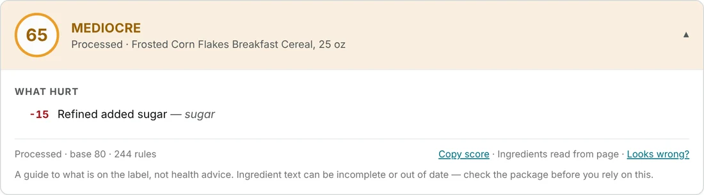
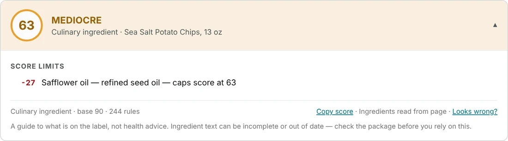
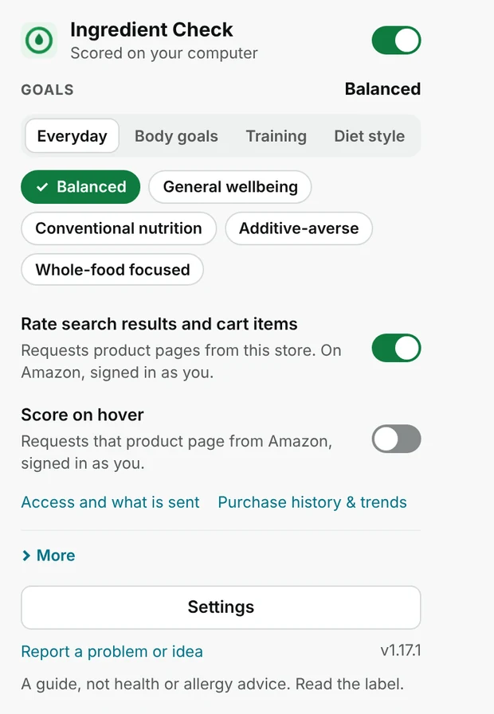

# Ingredient Check

**Understand grocery ingredient labels before you buy.**

Rates every food label **0–100** on ingredients, additives and processing,
on your own computer, with the weights you choose.

### [Explore all features →](https://ingrediantcheck-website.vercel.app/#install)

[Website](https://ingrediantcheck-website.vercel.app/) ·
[Install](#install) ·
[How to use it](#how-to-use-it) ·
[Privacy](#privacy) ·
[Troubleshooting](#troubleshooting) ·
[Docs](#more-information)

 

<picture>
  <source media="(prefers-color-scheme: dark)" srcset="website/img/score-oats-dark.webp">
  
</picture>

> [!NOTE]
> This is a guide to what is written on the label. It is not medical or allergy advice.
> Always read the package.

## What it does

When you shop on Amazon (and a growing list of other stores), Ingredient Check reads the ingredient
list and shows a score, with every point gained or lost spelled out. Nothing is a black box, and
nothing leaves your computer to be scored.

|   | Feature | What you get |
|---|---|---|
| 🏷️ | **Product pages** | A score and a full breakdown under the title; the toolbar icon shows it too |
| 🔎 | **Search results** | A small score on each food listing, with the reason on hover |
| 🛒 | **Carts** | A score on each item and the **cart average** |
| ↕️ | **Sort by score or unit price** | Two extra entries in Amazon's *Sort by* menu, and a side panel to rank and re-weight the list |
| 🎯 | **Your goals** | 20 goals you can combine, plus allergen, diet and avoid-list warnings that never change the score |
| 📈 | **Purchase history** | Opt-in monthly trends from the Amazon.com orders you actually made |

Coverage: **21 Amazon storefronts** plus **15 retailer previews** (Target, Walmart, Costco, Instacart,
Kroger and more). See [which stores are supported](docs/STORES.md).

## See it

<table>
  <tr>
    <td width="50%" valign="top">
      <b>Sorted by price per unit, with your priorities</b>  
      <picture>
        <source media="(prefers-color-scheme: dark)" srcset="website/img/sort-panel-dark.webp">
        
      </picture>
    </td>
    <td width="50%" valign="top">
      <b>Every score shows its working</b>  
      <picture>
        <source media="(prefers-color-scheme: dark)" srcset="website/img/score-flakes-dark.webp">
        
      </picture>
        
      <picture>
        <source media="(prefers-color-scheme: dark)" srcset="website/img/score-chips-dark.webp">
        
      </picture>
        
      <b>Pick your goals in one tap</b>  
      <picture>
        <source media="(prefers-color-scheme: dark)" srcset="website/img/popup-dark.webp">
        
      </picture>
    </td>
  </tr>
</table>

Screenshots are the real extension on sample products with generic names. The scores show how
the panel reads, not how any brand scores.

---

## Install

Ingredient Check installs from a download, in about two minutes. No Node or Python is needed unless
you want to build the package from source.

**1. Download.** Open the [latest release](https://github.com/jackson29382938/ingrediant_check/releases/latest) and pick the ZIP for your browser:

| Your browser | Download |
|---|---|
| Chrome 116 or newer | `ingredient-check-<version>.zip` |
| Firefox 142 or newer | `ingredient-check-<version>-firefox.zip` |

**2. Extract** it into a folder you will keep. Chrome reads the extension from that folder, so do not delete or move it.

<b>Chrome</b>

1. Open `chrome://extensions` and turn on **Developer mode** (top right).
2. Click **Load unpacked** and select the extracted folder, the one containing `manifest.json`.
3. Click the puzzle-piece icon in the toolbar and **pin** Ingredient Check.

You should see **Ingredient Check** in the list with no errors. A short setup opens the first time.

<b>Firefox</b>

1. Open `about:debugging#/runtime/this-firefox`.
2. Click **Load Temporary Add-on** and select `manifest.json` from the extracted folder.
3. Grant site access for the stores you use.

Temporary add-ons are removed when Firefox restarts, and a permanent install needs Mozilla signing.
See [browser installation and signing](docs/BROWSERS.md).

<b>Updating</b>

Download the newer ZIP, extract it over the files in the **same folder**, then press **Reload** on the
extension's card in `chrome://extensions`. Keeping the folder keeps your settings, local history and
the extension's identity.

<b>Build from source</b>

Needs **Node 20+** and **Python 3** (`python3` on PATH). From the repository root, run `npm run pack`.
The Chrome output is `dist/unpacked` and Firefox is `dist/firefox`. Development tests and setup are in
[docs/VERIFY.md](docs/VERIFY.md).

Step-by-step guide with troubleshooting: **[ingrediantcheck-website.vercel.app/install](https://ingrediantcheck-website.vercel.app/install)**.

---

## How to use it

| Where you are | What you see |
|---|---|
| An Amazon product page | A score for the ingredient list; the toolbar icon shows it too |
| An Amazon search results page | A small score on each food product |
| Your Amazon cart | A score on each item and the **cart average** |

- **Hover** a score to see why it got that number. **Click** it to open the product.
- **Sort:** on an Amazon grocery search, pick *Ingredient Check score: High to Low* or
  *Price per …: Low to High* from the *Sort by* menu. The side panel's **Price per** picker switches the
  unit (ounce, pound, gallon, count, 100 g and more).
- **Keyboard:** on an Amazon search page, press `Alt+Shift+H` to open the list sorted by score.

### Set it up for you

The first time you open the extension, a short setup asks about your **goals**, the **allergens and
diets** you avoid, and an **avoid list** of ingredients you do not want. Change any of it later from the
toolbar icon → **Settings**, or choose **Run setup again**.

---

## Privacy

- Scores are worked out on your computer. There is no account, no analytics and no ads.
- Settings back up through your browser's own sync, and you can turn that off.
- Every optional feature and exactly what it sends: [docs/PRIVACY.md](docs/PRIVACY.md) and the
  [privacy page](https://ingrediantcheck-website.vercel.app/privacy).

## Troubleshooting

<b>No Ingredient Check in <code>chrome://extensions</code></b>

Select the extracted release folder that directly contains `manifest.json`. Some extractors add an
extra folder around it; open it and choose the inner one.

<b>Errors on the extension card</b>

Check you downloaded the Chrome ZIP (the one without `-firefox` in its name), then press **Reload**.

<b>No score on a product</b>

The label may be missing or unreadable. The product page offers a paste box where you can type the
ingredients, and the extension scores what you paste.

<b>I updated and my settings are gone</b>

Extract the newer release into the **same** folder and press **Reload**. Loading a new folder makes
Chrome treat it as a different extension.

---

## More information

| | |
|---|---|
| 📖 [Full feature guide](docs/FULL-README.md) | Every feature in detail |
| 🏪 [Stores](docs/STORES.md) | Which stores are supported and what has been checked |
| 🎯 [Accuracy](docs/ACCURACY.md) | How well scores match real labels, by language |
| 🧮 [Scoring review](docs/SCORING-CALIBRATION-2026-10-01.md) | Every factor and default |
| 🌐 [Browsers](docs/BROWSERS.md) | Chrome and Firefox setup, signing and Google sign-in |
| 🧪 [Developer notes](docs/VERIFY.md) | Tests, harnesses and live checks |
| 🌍 [Website](https://ingrediantcheck-website.vercel.app/) | Screenshots, install guide, FAQ ([source](website/), [deployment](website/README.md)) |

Licensed under [MIT](LICENSE). Not affiliated with Amazon, Target, Walmart, Costco or any other retailer.

