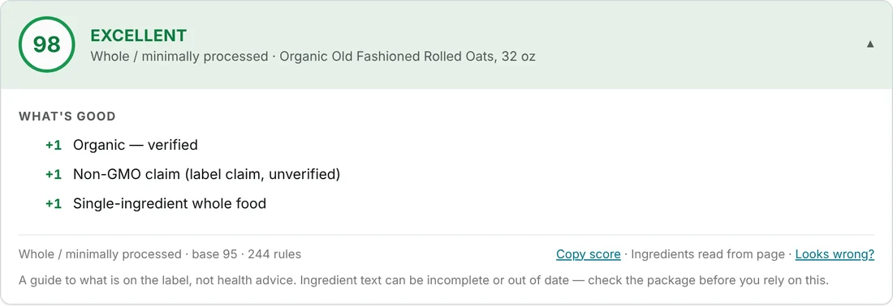
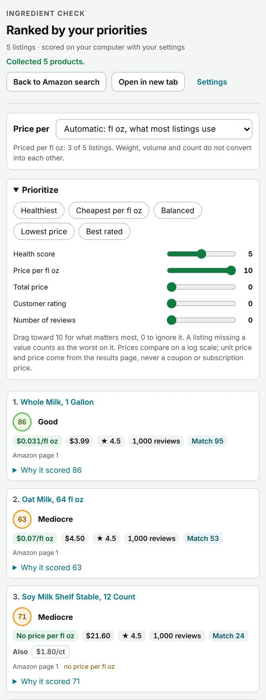
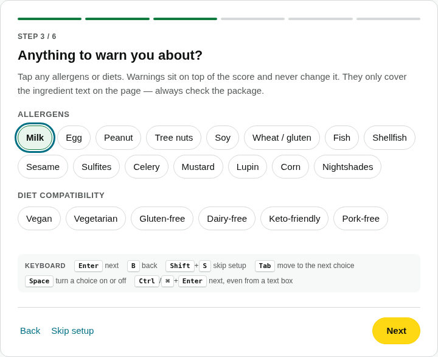
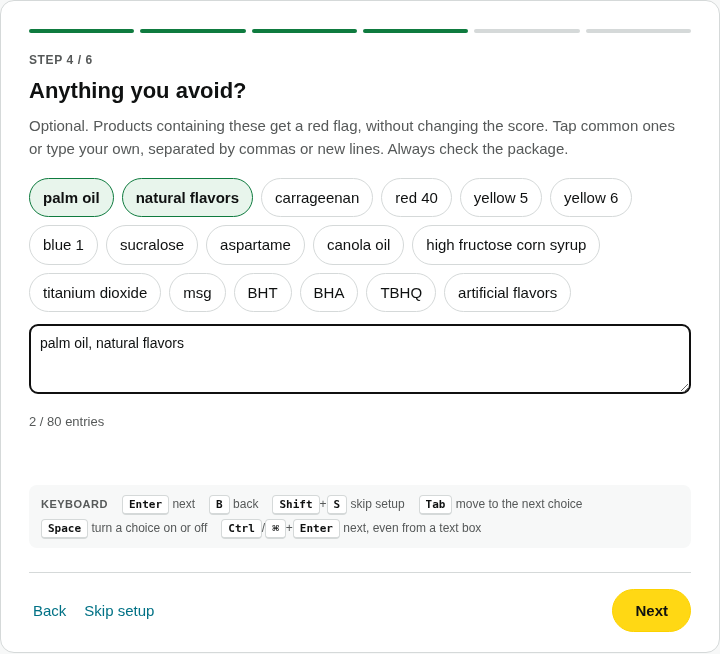
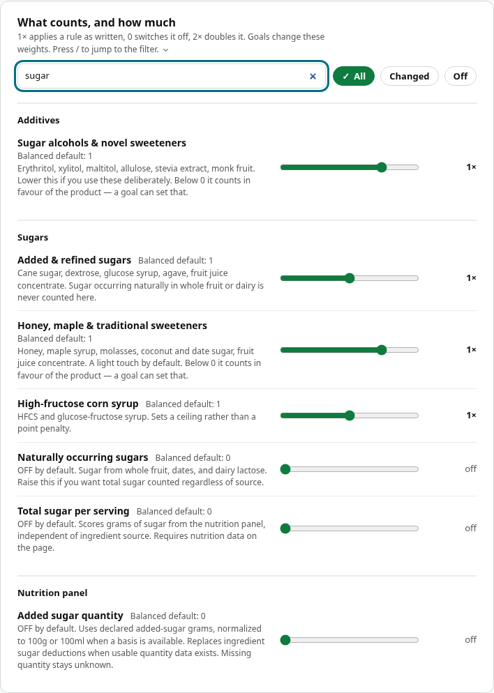
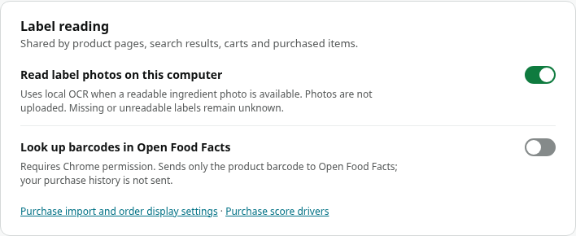
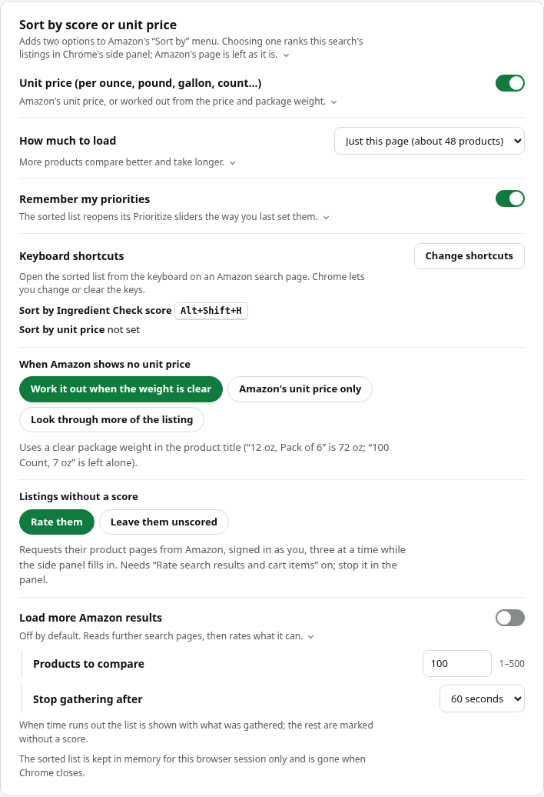
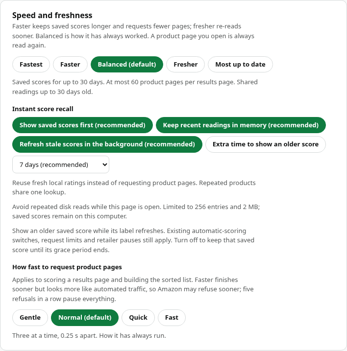
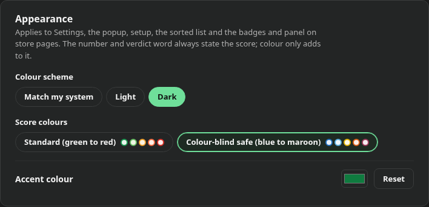

# Ingredient Check

**Understand grocery ingredient labels before you buy.**

A desktop **Chrome and Firefox** extension that scores readable grocery ingredient lists from
**0 to 100**, explains every bonus and deduction, and lets you choose which goals matter to you.
Scoring runs on your computer.

### [Download the latest release](https://github.com/jackson29382938/ingrediant_check/releases/latest)  ·  [Explore all features →](https://ingrediantcheck-website.vercel.app/#install)

[Install](#installation) ·
[Features](#features-and-examples) ·
[Stores](#which-stores-work) ·
[Privacy](#privacy-and-optional-accounts) ·
[Troubleshooting](#troubleshooting) ·
[Website](https://ingrediantcheck-website.vercel.app/) ·
[Get help](https://github.com/jackson29382938/ingrediant_check/issues)

 

<picture>
  <source media="(prefers-color-scheme: dark)" srcset="website/img/score-oats-dark.webp">
  
</picture>

> [!NOTE]
> Scores describe the available label under your selected settings. They are not medical or
> allergy advice. Always check the package. Missing labels are shown as unavailable, not given a
> guessed score.

Personal care and supplements use separate **label indices**. Supported categories are toothpaste,
mouthwash, deodorant/antiperspirant, shampoo, conditioner, body wash/soap, basic moisturizers, and
vitamins/supplements. Settings offers **Evidence-based** (default), **Minimal ingredients**, and
**Preference-focused** styles, plus an independent switch for these categories. Food scores keep
their existing rules. Missing label evidence stays unavailable. See [the rubric and sources](docs/PERSONAL-CARE.md).

## At a glance

|   | Feature | What you get |
|---|---|---|
| 🏷️ | **Product pages** | A score and a full breakdown under the title; the toolbar icon shows it too |
| 🔎 | **Search results** | A small score on each food listing, with the reason on hover |
| 🛒 | **Carts** | A score on each item and the **cart average** |
| ↕️ | **Sort by score or unit price** | Extra entries in Amazon's *Sort by* menu, and a side panel to rank and re-weight the list |
| 🎯 | **Your goals** | 20 goals you can combine, plus allergen, diet and avoid-list warnings that never change the score |
| 📈 | **Purchase history** *(opt-in preview)* | Monthly trends from the Amazon.com orders you actually made |

Scoring is local and open: [how a score is built](https://ingrediantcheck-website.vercel.app/scoring) · [what is sent and when](docs/PRIVACY.md).

## Installation

**Start with the ZIP under “Assets” on the [latest release page](https://github.com/jackson29382938/ingrediant_check/releases/latest).**
You do **not** need Node, Python, a terminal or a Google account to install and score locally.

| Browser | Download under Assets | Installation type |
|---|---|---|
| **Chrome 116+** | `ingredient-check-<version>.zip` | Extract and use **Load unpacked** |
| **Firefox 142+** | `ingredient-check-<version>-firefox.zip` | **Temporary add-on**; removed when Firefox restarts |

Do not choose GitHub’s automatically generated **Source code (zip)** or **Source code (tar.gz)**
for these installation steps. The browser packages include the files needed to run the extension.

### Chrome: download → extract → load

1. Download the **Chrome ZIP** listed above and **extract all files** into a permanent folder,
   such as `Documents/Ingredient Check`. Keep this folder after installation.
2. Open **`chrome://extensions`** in Chrome’s address bar.
3. Turn on **Developer mode** in the top right, then click **Load unpacked**.
4. Select the **extracted folder containing `manifest.json`**, not the ZIP or its parent folder.
   You should now see an **Ingredient Check** extension card.
5. Finish the setup page. Choose your goals, warnings and optional features. If setup does not
   open, use the extension’s **Settings → Run setup again**.
6. Click Chrome’s **Extensions** puzzle-piece icon and pin **Ingredient Check**. Open or refresh
   a supported grocery page to start seeing ratings.

<b>Updating</b>

Download the new Chrome ZIP, replace the extension files in the **same install
folder**, click **Reload** on its card at `chrome://extensions`, then refresh your shopping tabs.
Keep the folder and existing extension installed to preserve its identity and local history.

<b>Firefox: temporary installation</b>

The GitHub Firefox ZIP is **unsigned**. It is suitable for temporary installation and testing;
a permanent installation in standard Firefox requires a **Mozilla-signed XPI**.

1. Download the **Firefox ZIP** listed above and extract it.
2. Open **`about:debugging#/runtime/this-firefox`** in Firefox’s address bar.
3. Click **Load Temporary Add-on**, then select `manifest.json` inside the extracted Firefox folder.
4. Finish setup and grant access to the store websites you use if Firefox asks. Open or refresh
   a grocery page to check that ratings appear.

Firefox removes temporary add-ons on restart. Repeat these steps to load it again; use a signed
package for ongoing use. See [browser installation, permissions and signing](docs/BROWSERS.md).

## Features and examples

These screenshots show the **actual extension UI** using saved label fixtures and synthetic purchase
records. They contain no personal account or order data. Scores vary with the label, goals and
scoring version. **Click any screenshot to open the full-size image.** Previews are individually
sized to keep this page compact. [Screenshot details](docs/screenshots/README.md).

### See what contributed to a score

Open a grocery product and expand its score panel to see the ingredient bonuses, deductions and
score limits. The example below uses a saved potato-chip label and balanced scoring settings.

For example, a whole-food ingredient may earn a bonus while an oil or additive triggers a deduction
or limit. **Allergen, diet and avoid-list warnings are separate from the numerical score.** Hover over
listing, cart or order badges for details when **Score on hover** is enabled.

### Make the scoring fit your goals

Combine goals during setup, then adjust their importance and individual weights in Settings. Choose
a settings level from **Minimal** to **Everything** to control how many options you see.

For example, select **Whole-food focused**, add an allergen warning, and enter
**`palm oil, natural flavors`** in the avoid list. The comma separates those into two ingredients.
Change goals or warnings later from the extension icon → **Settings**.

### Compare products while shopping

| Where | What you can do |
|---|---|
| **Product pages** | Read the score breakdown; paste label text when the site has no readable label |
| **Search results** | Compare food-product badges; on Amazon grocery searches, sort by score or price per unit |
| **Carts** | Review item ratings and the cart average where the store adapter can identify items and labels |
| **Amazon Orders** *(opt-in preview)* | Import actual purchases, inspect item ratings and open purchase trends |

On Amazon grocery searches, choose **Ingredient Check score: High to Low** or **Price per …: Low to High**
in Amazon's *Sort by* menu, or press **`Alt+Shift+H`** to open the score-sorted list. The menu names the
unit most listings on the page use (ounce, gallon, count, 100 g). In the side panel, the **Price per**
picker switches to any weight, volume or count unit. Weight, volume and count do not convert into each
other, so listings with no price in the chosen unit go last and say so.

<picture>
  <source media="(prefers-color-scheme: dark)" srcset="website/img/sort-panel-dark.webp">
  
</picture>

Automatic search/cart scoring, badge placement, hover details, local-cache behavior, speed,
appearance and score palettes are adjustable in Settings. Cached readings help repeat visits load
faster; freshness, changed goals and changed scoring rules can still require a refresh or rescore.

### Check labels and keep a shopping shortlist

Use **Check a label · Saved & compare** in the popup to paste ingredients, read a local photo,
or explicitly look up a barcode. Review photo text before scoring. **Save product** on a product's
score panel keeps its label in a local shopping list, independently of expiring caches.

Detailed comparisons show current-goal scores, warning evidence, available nutrients, missing
factors and score contributions. Goal previews leave your settings unchanged. Amazon's comparison
panel can filter by maximum price, minimum score, selected warning matches and label evidence.
Unknown warnings remain a separate choice; filters do not confirm allergen absence.

On Amazon Orders pages, item scores also work with history import off. The compact bar shows its
two buttons, a small graph only when rated history exists, and available daily, weekly and monthly
averages. Saving purchase records and account sync remain opt-in.

### Non-food price comparisons

On Amazon non-food search pages, **Price per …: Low to High** still works when unit-price sorting
is enabled. Compare per ounce, fluid ounce, item or another compatible unit from the listings.
This lightweight view hides health scores and health priorities and skips ingredient, barcode, OCR
and certification lookups. Missing or incompatible package sizes remain unknown rather than being
guessed. Loading extra results pages still follows your existing sort settings.

### Keep the comparison on your current search

An open side panel or comparison tab follows new Amazon searches in its original source tab by
default. It updates the results without requiring another sort-menu selection. Other Amazon tabs
cannot replace that comparison, and closing the comparison stops automatic collection.
Turn off **Settings → Sort by score or unit price → Follow new searches in the side panel** to keep
the previous results instead. Non-food searches continue to use price-only comparisons.

### Explore your purchase trends

Opt into **Amazon purchase history** in setup or Purchase history’s own settings. Import an opened
Orders page, or use **Scan all Amazon orders** to work through available pages and year filters in
a background tab, with progress, time estimates, pause and resume. Keep the browser open; sign-in
checks can pause the scan.

- **Preserve the original scores**, or compare saved labels using your current goals and weights.
- Track the average over time, score distribution and biggest net bonuses and deductions.
- Filter by date, product, status, rating or score; sort imported items and inspect statistical details.
- Distinguish **orders** from **product entries**: three distinct products in one order are one order
  and three entries. Purchased quantities are not inferred.

Only confirmed purchases drive trends; viewed products, carts, cancellations and returns are
excluded. These charts describe purchases, not what you ate or medical outcomes. Confidence intervals
in the statistical view describe variation in the recorded sample, not certainty that a health score
is correct. [Purchase-history guide](docs/PURCHASE-HISTORY.md).

### More of the interface

Seven more views of the controls available in setup and Settings. Advanced options are shown with
the **Everything** settings level; the appearance example uses dark mode. Click to enlarge.

| Setup and preferences | Scoring and display controls |
|---|---|
| **Allergen and diet warnings**  Choose warning flags independently of score weights. | **Your own avoid list**  Comma-separated palm oil and natural flavors are counted as two entries. |
| **Fine-tune scoring weights**  Filter categories and adjust individual rule weights. | **Label photos and barcodes**  Control local OCR and optional Open Food Facts lookup. |
| **Search and unit-price sorting**  Choose comparison limits and how to handle missing unit prices. | **Cache, speed and freshness**  Adjust saved-score reuse, refresh behavior and request pace. |
| **Dark mode and score palettes**  Choose a theme, colour-blind-safe palette and accent. | **[Explore all features →](https://ingrediantcheck-website.vercel.app/#install)** Screenshots, the scoring method, store coverage, an install guide and an FAQ on the website. |

## Which stores work?

**Amazon.com** is the primary live-checked store. **Target, Walmart, Costco, Instacart, Kroger,
Fry’s, Ralphs, King Soopers, Smith’s, Fred Meyer, QFC, Harris Teeter, Dillons, Safeway and Albertsons**
have preview adapters with varying live verification. Other Amazon storefronts share the adapter
but have not all been checked individually.

Product, search and cart behavior depends on the store layout, permissions and available labels.
Purchase-history import currently covers **Amazon.com Orders only**. A preview is not a guarantee
that every page works. See the [coverage and verification table](docs/STORES.md) or the [stores page](https://ingrediantcheck-website.vercel.app/stores) for current limits.

## Privacy and optional accounts

- **Scoring and local caches run on your device.** On-device OCR can read supported label photos.
- A **Google account is optional** for local scoring. Google sign-in enables optional account backup
  and purchase-history sync; Chrome/Firefox profile backup uses the browser’s own sync service.
- Settings backup is on by default. Opting into Amazon history also enables automatic Google-account
  history sync; you can switch it off or use **Sync now** in Purchase history.
- Barcode lookup and other online lookups depend on their settings and permissions. Diagnostics and
  sharing product readings are off by default.

Read the [full privacy policy](docs/PRIVACY.md) for exactly what is stored, fetched and uploaded.

## Troubleshooting

| Problem | What to check |
|---|---|
| Cannot find the right download | Expand **Assets** on the latest release. Choose the browser ZIP, not **Source code**. |
| Chrome says the manifest is missing | Extract the ZIP first; select the folder that directly contains `manifest.json`. |
| No ratings after installation or an update | Refresh the shopping tab, check the extension is enabled, and allow access to that store. |
| “Label unavailable” | Update to 1.19.1 for watermelon, jujube, certified-organic and encoded-label fixes. Amazon carts reuse saved labels and can use enabled barcode/photo readers. Open the product or paste ingredients if its public label still cannot be read. |
| Firefox disappears after restart | That is expected for a temporary add-on. Permanent installation requires Mozilla signing. |
| Google reports a redirect URI mismatch | Local scoring still works. The developer must register the exact redirect URL shown in Google backup settings. See [OAuth setup](docs/BROWSERS.md#google-sign-in-and-optional-data-sharing). |
| Still stuck | [Open an issue](https://github.com/jackson29382938/ingrediant_check/issues) with your browser, extension version, store URL and a redacted screenshot. Leave out account and order details. |

## More information

| | |
|---|---|
| 🌍 [Website](https://ingrediantcheck-website.vercel.app/) | Screenshots, install guide, FAQ |
| 📖 [Full feature guide](docs/FULL-README.md) | Every feature in detail |
| 🧮 [How a score is built](https://ingrediantcheck-website.vercel.app/scoring) | The five steps, score bands and limits |
| 🏪 [Stores](docs/STORES.md) | What has been checked on each store |
| 🎯 [Scoring accuracy and limitations](docs/ACCURACY.md) | Evidence by language and reading method |
| 🌐 [Browser installation and signing](docs/BROWSERS.md) | Chrome, Firefox and Google sign-in |
| 🧪 [Developer setup and tests](docs/VERIFY.md) | Harnesses and live checks |
| ✅ [Current validation](docs/CURRENT-VALIDATION.md) | What was run for this release, and what it does not establish |
| 🚀 [Website source](website/) and [deployment steps](website/README.md) | Static site on Vercel |

Building from source is optional: with **Node 20+ and Python 3**, run `npm run pack` in the repository
root to create both browser ZIPs in `dist/`. The extracted Chrome folder is `dist/unpacked` and
Firefox is `dist/firefox`.

Licensed under [MIT](LICENSE). Not affiliated with Amazon, Target, Walmart, Costco or any other retailer.

